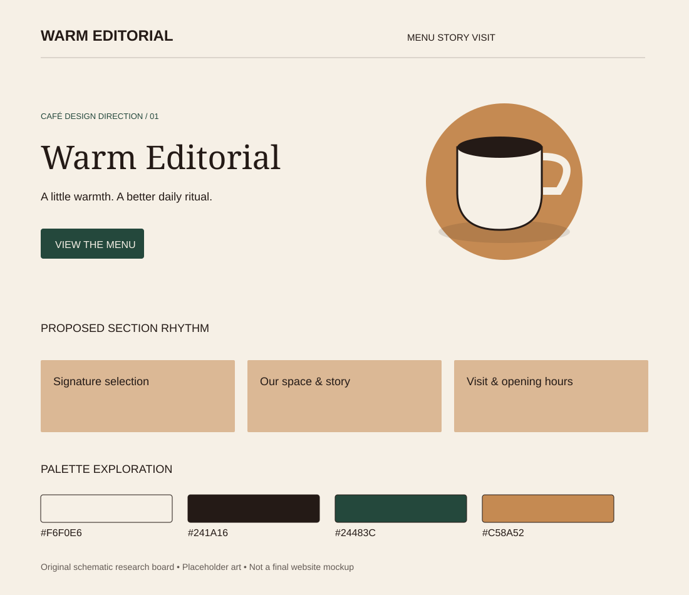

# Warm Editorial

Research direction 1 of 7 · 5 November 2026 · Proposed concept, not an approved design.

## Best fit and overall impression

Neighborhood cafés and premium everyday coffee. Suggested headline tone: “A little warmth. A better daily ritual.”

Asymmetric split hero: expressive headline left, large ceramic cup right. Alternate generous image-and-text stories with clean product cards.

## Visual system

- Proposed palette: `#F6F0E6`, `#241A16`, `#24483C`, `#C58A52`. Base, text, action/accent and supporting color respectively; test actual contrast before use.
- Typography direction: Fraunces + Manrope. Font choices are candidates; exact files and licenses remain to check.
- Photography: Ivory ceramics, warm window light, oak tables and real venue photos.
- 3D or illustration: A softly lit cup-and-saucer render with a subtle handmade rim; croissant still life as support.

## Navigation, sections and footer

**Navigation:** Small wordmark, Menu / Story / Visit, forest View Menu button.

**Section rhythm:** Hero → address and hours strip → signature drinks → craft story → space gallery → visit details.

**Footer:** Deep forest, cream text, three clear columns for Explore, Visit and Contact.

On mobile, stack the hero, retain a visible menu path, keep directions easy to reach and preserve readable prices. The design should still communicate its character without animation.

## Motion and scrolling

A short settling cup entrance, once-only section fades and restrained image lift. Native scroll.

Use reduced-motion alternatives and leave practical content outside canvas. See [shared effects research](../../02-motion-and-3d.md) for timings, performance targets and fallback details.

## What makes this different

This direction changes composition, imagery, typography and motion as well as color. Its primary differentiator is the layout and atmosphere described above; do not present it as merely a recolored version of another option.

## Risks and improvements

Can become generic if it relies on beige stock photography. Give the brand its own typography, copy and cup shape.

Keep real menu prices, address, hours and the primary visitor action accessible. Never invent reviews or business claims. Check performance with a static hero first, then add only justified effects.

## Client discussion

Show the visual board and two linked references. Explain the atmosphere, the hero concept, the practical menu/visit flow and the motion level. Ask whether it matches the real venue and audience before expanding it into a full mockup.

## Evidence boundaries

The board is original schematic artwork with placeholder shapes, not a screenshot, final mockup, generated photo or live website. Source notes distinguish reviewed content from unverified visual inspiration. No third-party assets are copied into this folder.
