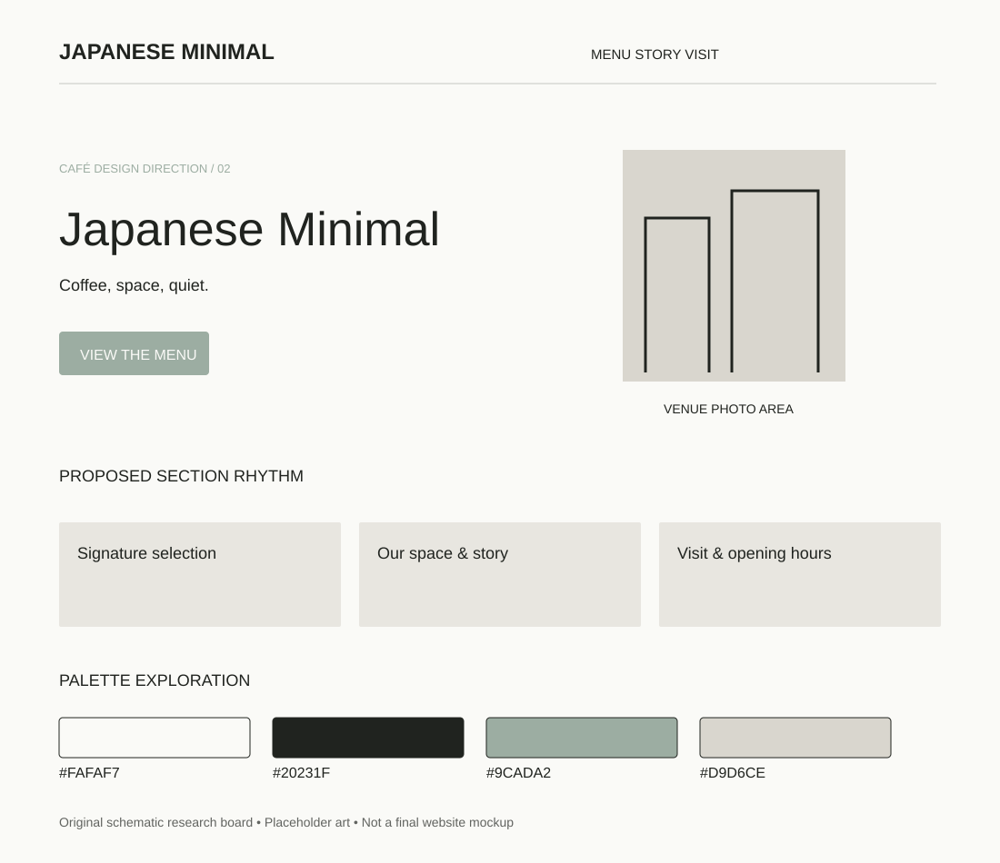

# Japanese Minimal

Research direction 2 of 7 · 5 November 2026 · Proposed concept, not an approved design.

## Best fit and overall impression

Architecture-led specialty cafés and compact premium coffee bars. Suggested headline tone: “Coffee, space, quiet.”

Large whitespace, a small headline and one dominant architectural photo. Precise grid, thin rules and very few decorative shapes.

## Visual system

- Proposed palette: `#FAFAF7`, `#20231F`, `#9CADA2`, `#D9D6CE`. Base, text, action/accent and supporting color respectively; test actual contrast before use.
- Typography direction: DM Sans with a restrained serif accent. Font choices are candidates; exact files and licenses remain to check.
- Photography: Natural stone, stainless steel, pale wood and honest uncluttered interiors.
- 3D or illustration: A sculptural unbranded porcelain cup as a static render; real venue architecture remains the hero.

## Navigation, sections and footer

**Navigation:** Compact wordmark, Menu / Locations / About, simple text Directions action.

**Section rhythm:** Venue hero → essential visit details → concise menu → coffee philosophy → architectural gallery → location.

**Footer:** Light background with thin dividing lines; address and opening hours receive equal weight to brand links.

On mobile, stack the hero, retain a visible menu path, keep directions easy to reach and preserve readable prices. The design should still communicate its character without animation.

## Motion and scrolling

Small opacity changes and subtle image reveals; little or no parallax. Optional model rotation only on request.

Use reduced-motion alternatives and leave practical content outside canvas. See [shared effects research](../../02-motion-and-3d.md) for timings, performance targets and fallback details.

## What makes this different

This direction changes composition, imagery, typography and motion as well as color. Its primary differentiator is the layout and atmosphere described above; do not present it as merely a recolored version of another option.

## Risks and improvements

Tiny typography and excessive whitespace can hide useful information. Keep body copy and prices readable.

Keep real menu prices, address, hours and the primary visitor action accessible. Never invent reviews or business claims. Check performance with a static hero first, then add only justified effects.

## Client discussion

Show the visual board and two linked references. Explain the atmosphere, the hero concept, the practical menu/visit flow and the motion level. Ask whether it matches the real venue and audience before expanding it into a full mockup.

## Evidence boundaries

The board is original schematic artwork with placeholder shapes, not a screenshot, final mockup, generated photo or live website. Source notes distinguish reviewed content from unverified visual inspiration. No third-party assets are copied into this folder.
