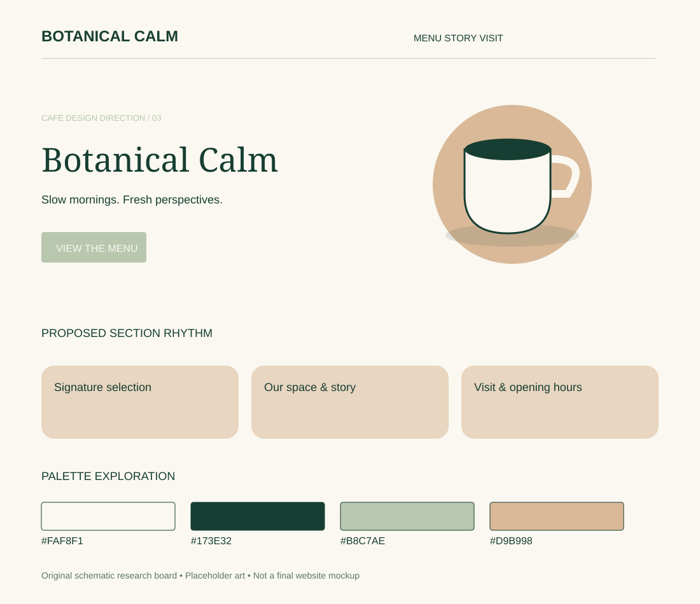

# Botanical Calm

Research direction 3 of 7 · 5 November 2026 · Proposed concept, not an approved design.

## Best fit and overall impression

Garden cafés, matcha bars and relaxed brunch venues. Suggested headline tone: “Slow mornings. Fresh perspectives.”

Rounded image windows, calm green surfaces and a spacious two-column hero. Organic accents support a structured readable grid.

## Visual system

- Proposed palette: `#FAF8F1`, `#173E32`, `#B8C7AE`, `#D9B998`. Base, text, action/accent and supporting color respectively; test actual contrast before use.
- Typography direction: DM Serif Display + DM Sans. Font choices are candidates; exact files and licenses remain to check.
- Photography: Plants, matcha, pale plaster and soft daylight; avoid green overlays that distort food color.
- 3D or illustration: A matte matcha bowl and whisk still life or a cream cup with a leaf-shaped shadow.

## Navigation, sections and footer

**Navigation:** Quiet horizontal navigation, Menu / Space / Visit, dark-green Visit Us action.

**Section rhythm:** Daylight hero → seasonal drinks → brunch pairings → garden/space story → gallery → visit and access.

**Footer:** Deep green with practical opening hours; a small botanical line drawing can add character.

On mobile, stack the hero, retain a visible menu path, keep directions easy to reach and preserve readable prices. The design should still communicate its character without animation.

## Motion and scrolling

Slow image fades and tiny decorative leaf movement if desired; static equivalent for reduced motion.

Use reduced-motion alternatives and leave practical content outside canvas. See [shared effects research](../../02-motion-and-3d.md) for timings, performance targets and fallback details.

## What makes this different

This direction changes composition, imagery, typography and motion as well as color. Its primary differentiator is the layout and atmosphere described above; do not present it as merely a recolored version of another option.

## Risks and improvements

Avoid unsupported wellness or sustainability claims. Green-on-green text can lose contrast.

Keep real menu prices, address, hours and the primary visitor action accessible. Never invent reviews or business claims. Check performance with a static hero first, then add only justified effects.

## Client discussion

Show the visual board and two linked references. Explain the atmosphere, the hero concept, the practical menu/visit flow and the motion level. Ask whether it matches the real venue and audience before expanding it into a full mockup.

## Evidence boundaries

The board is original schematic artwork with placeholder shapes, not a screenshot, final mockup, generated photo or live website. Source notes distinguish reviewed content from unverified visual inspiration. No third-party assets are copied into this folder.
