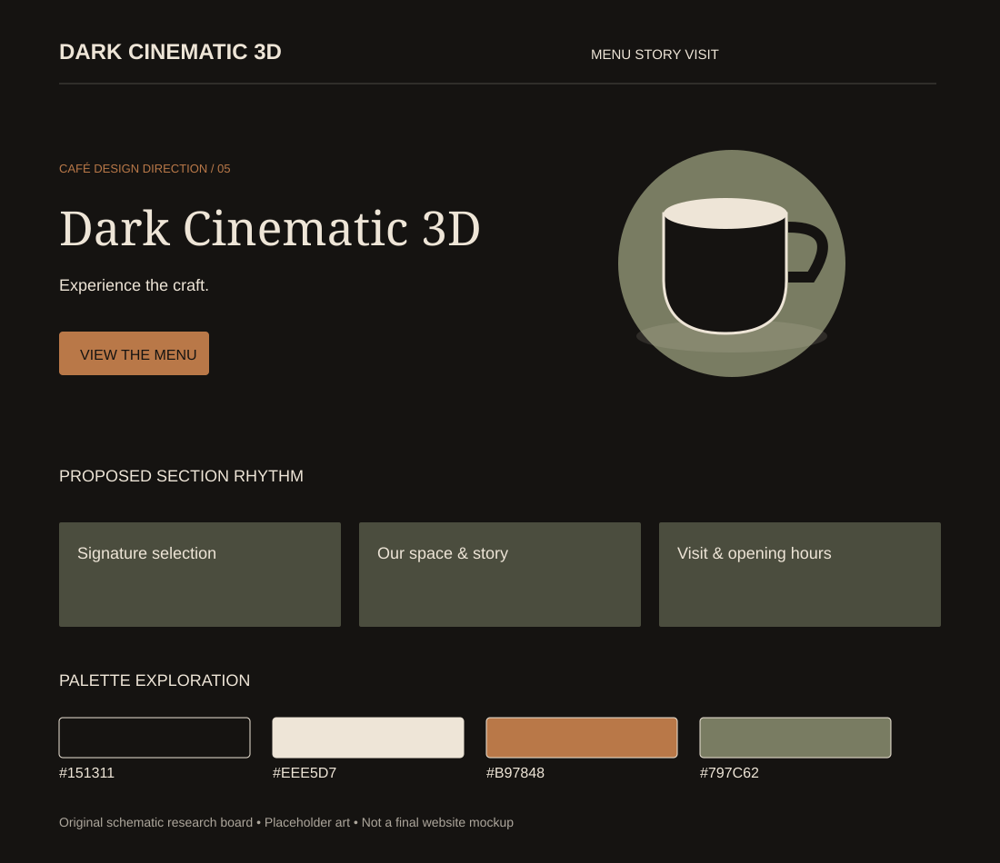

# Dark Cinematic 3D

Research direction 5 of 7 · 5 November 2026 · Proposed concept, not an approved design.

## Best fit and overall impression

Experimental specialty coffee, premium roastery and evening café. Suggested headline tone: “Experience the craft.”

Dark stage, dramatic cup lighting, large elegant headline and one clear action. Follow the hero with a light or calmer readable menu surface.

## Visual system

- Proposed palette: `#151311`, `#EEE5D7`, `#B97848`, `#797C62`. Base, text, action/accent and supporting color respectively; test actual contrast before use.
- Typography direction: A strong editorial serif + Manrope. Font choices are candidates; exact files and licenses remain to check.
- Photography: Directional studio light, warm copper reflections and authentic macro coffee photography.
- 3D or illustration: One optimized GLB cup with baked lighting and matching poster; beans can be instanced as small accents.

## Navigation, sections and footer

**Navigation:** Opaque dark header, Menu / Craft / Visit, light high-contrast primary action.

**Section rhythm:** Cup hero → visit essentials → signature drinks → optional short brewing scene → venue photography → visit.

**Footer:** Quiet ink surface with generous spacing; no cinematic effects around contact information.

On mobile, stack the hero, retain a visible menu path, keep directions easy to reach and preserve readable prices. The design should still communicate its character without animation.

## Motion and scrolling

One coordinated cup turn or short beans-to-cup story. GSAP only if needed; Three.js/Fiber for the scene. Stop offscreen and provide a poster fallback.

Use reduced-motion alternatives and leave practical content outside canvas. See [shared effects research](../../02-motion-and-3d.md) for timings, performance targets and fallback details.

## What makes this different

This direction changes composition, imagery, typography and motion as well as color. Its primary differentiator is the layout and atmosphere described above; do not present it as merely a recolored version of another option.

## Risks and improvements

Highest performance and motion risk. Do not put menu text in canvas or make scrolling depend on the 3D sequence.

Keep real menu prices, address, hours and the primary visitor action accessible. Never invent reviews or business claims. Check performance with a static hero first, then add only justified effects.

## Client discussion

Show the visual board and two linked references. Explain the atmosphere, the hero concept, the practical menu/visit flow and the motion level. Ask whether it matches the real venue and audience before expanding it into a full mockup.

## Evidence boundaries

The board is original schematic artwork with placeholder shapes, not a screenshot, final mockup, generated photo or live website. Source notes distinguish reviewed content from unverified visual inspiration. No third-party assets are copied into this folder.
