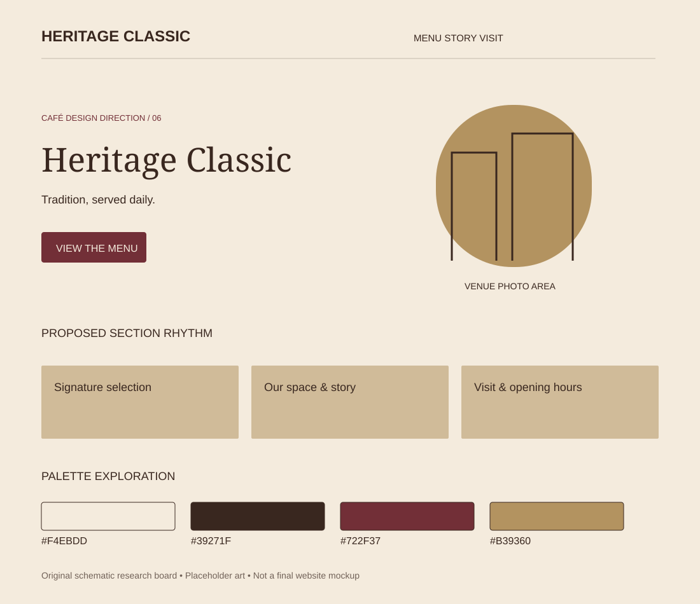

# Heritage Classic

Research direction 6 of 7 · 5 November 2026 · Proposed concept, not an approved design.

## Best fit and overall impression

Historic cafés, patisseries and an elegant sit-down experience. Suggested headline tone: “Tradition, served daily.”

Centered masthead, framed photography, thin ornamental rules and a symmetrical opening. Editorial two-column sections for history and specialties.

## Visual system

- Proposed palette: `#F4EBDD`, `#39271F`, `#722F37`, `#B39360`. Base, text, action/accent and supporting color respectively; test actual contrast before use.
- Typography direction: Cormorant Garamond + a readable contemporary sans-serif. Font choices are candidates; exact files and licenses remain to check.
- Photography: Real architecture, pastry detail, polished wood, ceramic service and archival material with rights.
- 3D or illustration: A porcelain espresso set rendered like a still-life photograph; decorative border as original SVG.

## Navigation, sections and footer

**Navigation:** Masthead above a clear Menu / Our Story / Visit row; Reserve only if supported.

**Section rhythm:** Venue or pastry hero → specialty highlights → real history → menu → rooms and experience → reservations/visit.

**Footer:** Burgundy or espresso with cream text, full address, hours and understated utility links.

On mobile, stack the hero, retain a visible menu path, keep directions easy to reach and preserve readable prices. The design should still communicate its character without animation.

## Motion and scrolling

Slow crossfades, modest image reveal and minimal navigation transitions. Normal document scroll.

Use reduced-motion alternatives and leave practical content outside canvas. See [shared effects research](../../02-motion-and-3d.md) for timings, performance targets and fallback details.

## What makes this different

This direction changes composition, imagery, typography and motion as well as color. Its primary differentiator is the layout and atmosphere described above; do not present it as merely a recolored version of another option.

## Risks and improvements

Do not invent a founding date or imply a heritage the café does not have. Gold often fails as small text.

Keep real menu prices, address, hours and the primary visitor action accessible. Never invent reviews or business claims. Check performance with a static hero first, then add only justified effects.

## Client discussion

Show the visual board and two linked references. Explain the atmosphere, the hero concept, the practical menu/visit flow and the motion level. Ask whether it matches the real venue and audience before expanding it into a full mockup.

## Evidence boundaries

The board is original schematic artwork with placeholder shapes, not a screenshot, final mockup, generated photo or live website. Source notes distinguish reviewed content from unverified visual inspiration. No third-party assets are copied into this folder.
