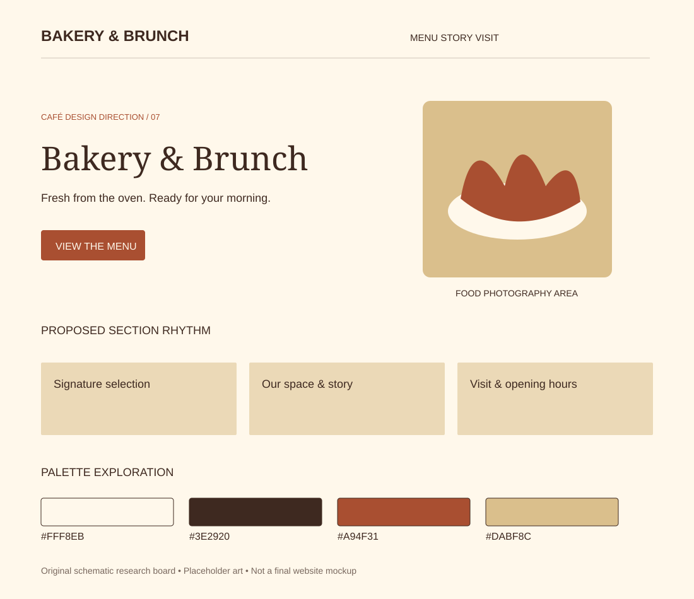

# Bakery & Brunch

Research direction 7 of 7 · 5 November 2026 · Proposed concept, not an approved design.

## Best fit and overall impression

Food-led cafés, artisan bakeries and weekend brunch destinations. Suggested headline tone: “Fresh from the oven. Ready for your morning.”

Appetizing edge-to-edge food photo, short headline and prominent menu/preorder links. Large image-led food categories followed by readable prices.

## Visual system

- Proposed palette: `#FFF8EB`, `#3E2920`, `#A94F31`, `#DABF8C`. Base, text, action/accent and supporting color respectively; test actual contrast before use.
- Typography direction: DM Serif Display + Manrope. Font choices are candidates; exact files and licenses remain to check.
- Photography: Fresh pastry texture, real portions, natural daylight and a warm human baking process.
- 3D or illustration: Croissant-and-espresso still life; prefer real food photos for menu accuracy. A stylized pastry render may support the brand.

## Navigation, sections and footer

**Navigation:** Menu / Bakery / Visit with Preorder only when available; make pickup information obvious.

**Section rhythm:** Food hero → today’s specialties → drinks and brunch → baking story → preorder/pickup details → venue and hours.

**Footer:** Warm cream or espresso, clear pickup information, contact and real operating hours.

On mobile, stack the hero, retain a visible menu path, keep directions easy to reach and preserve readable prices. The design should still communicate its character without animation.

## Motion and scrolling

Simple card reveals and understated photo zoom on hover. Avoid perpetual steam or rotating food carousels.

Use reduced-motion alternatives and leave practical content outside canvas. See [shared effects research](../../02-motion-and-3d.md) for timings, performance targets and fallback details.

## What makes this different

This direction changes composition, imagery, typography and motion as well as color. Its primary differentiator is the layout and atmosphere described above; do not present it as merely a recolored version of another option.

## Risks and improvements

Beautiful food imagery cannot substitute for availability, prices or pickup instructions. Avoid unrealistic rendered food portions.

Keep real menu prices, address, hours and the primary visitor action accessible. Never invent reviews or business claims. Check performance with a static hero first, then add only justified effects.

## Client discussion

Show the visual board and two linked references. Explain the atmosphere, the hero concept, the practical menu/visit flow and the motion level. Ask whether it matches the real venue and audience before expanding it into a full mockup.

## Evidence boundaries

The board is original schematic artwork with placeholder shapes, not a screenshot, final mockup, generated photo or live website. Source notes distinguish reviewed content from unverified visual inspiration. No third-party assets are copied into this folder.
